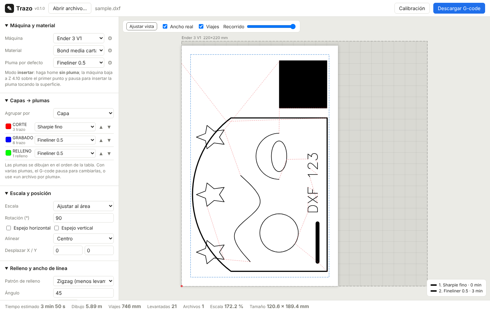

# Trazo — G-code para plotter de pluma en impresoras 3D

Convierte **SVG, DXF, PNG y JPG** en G-code para dibujar con plumas, marcadores o
bolígrafos montados junto al hotend de una impresora 3D cartesiana (Ender 3 V1,
Ender 3 V2/Pro, Ender 5, TwoTrees Bluer, Tronxy, Anet A8, máquinas con Klipper…).

El **ancho de línea** se ajusta al diámetro de la punta:

- **Rellenos compensados:** el contorno se contrae ½ punta, así la tinta llega
  justo al borde del diseño y no lo rebasa.
- **Separación de pasadas:** es `punta × (1 − traslape)`.
- **Trazos más gruesos que la punta:** se dibujan con varias pasadas paralelas.
- **Detalles más finos que la punta:** se dibujan por su eje central, con aviso.

---

## 1. Instalación

### Windows, sin Python (recomendado)
1. En GitHub, abra **Releases** y descargue `Trazo-windows.zip`.
   - Si no hay un Release, vaya a **Actions → build-windows**, abra la última
     ejecución correcta y descargue el artefacto **Trazo-windows**.
2. Descomprima el archivo y abra `Trazo\Trazo.exe`. Se abre el navegador con
   la interfaz (`http://127.0.0.1:8765`).
3. La ventana negra es el servidor local: ciérrela para salir.

> Windows SmartScreen puede advertir «aplicación no reconocida» porque el
> ejecutable no está firmado: elija *Más información → Ejecutar de todas formas*.

El ejecutable lo compila GitHub Actions (`.github/workflows/windows.yml`):
- en cada push a `main` genera un artefacto;
- al crear una etiqueta `v*` (por ejemplo `v0.1.0`) publica un Release.

### Desde el código (desarrollo, requiere Python 3.10+)
```bash
python -m venv .venv
.venv/bin/pip install -e .          # Windows: .venv\Scripts\pip install -e .
.venv/bin/trazo                     # abre la interfaz web
```
Los scripts `Trazo.bat` y `build_windows.bat` sirven solo en PCs **con Python
instalado**.



---

## 2. Flujo de trabajo en la máquina

1. **Monte el soporte con resorte** junto al hotend y **mida el offset** de la
   punta respecto a la boquilla, en X y en Y, con un vernier. Anótelo en el
   perfil de la máquina (⚙ → *Offset pluma X/Y*): + es a la derecha o hacia el
   fondo. *El hotend y la cama no se calientan nunca.*
2. **Fije el material** contra una escuadra en la cama. Su posición va en el
   perfil del material (*Posición X/Y* de la esquina inferior izquierda).
   El grosor del material es importante: papel 0.1 mm, cartón 2 mm, MDF 3 mm, etc.
3. **Abra el archivo** en Trazo:
   - Asigne una pluma a cada color o capa.
   - Ajuste la escala, la posición y el relleno.
   - Revise la vista previa y descargue el `.gcode` a la **tarjeta SD**.
4. **En la impresora (modo *insertar*, por defecto):**
   - La máquina hace home **sin pluma**.
   - Baja sobre el primer punto del dibujo hasta la altura de contacto
     (grosor del material + holgura de la boquilla) y **pausa**.
   - Inserte la pluma hasta que **toque la superficie**, apriétela y
     presione la perilla para continuar.
   - Al dibujar, la máquina baja `presión` mm (0.5 mm por defecto) para
     comprimir el resorte, y sube `levantar` mm para los viajes.
5. **Varias plumas:**
   - **Un solo archivo:** antes de cada pluma nueva pausa para *retirar* la
     anterior, y luego pausa sobre el punto de inicio para *insertar* la nueva.
   - **«Un archivo por pluma»:** genera un `.zip` con un archivo por color.
     Úselo si el firmware no soporta `M0`.

> **Modo *fijo*:** si la pluma va siempre montada, use `contact_mode = fixed` y
> calibre `contact_z_fixed`, la Z en la que la punta toca la cama vacía; el
> grosor del material se suma solo. Cuidado: el `G28` de Z puede chocar la
> pluma contra la cama. Considere `home = xy`.

### Calibración de la pluma
Use el botón **Calibración** (o `trazo calibrate --pen "…"`). Dibuja:
- **cuadros con traslape del 0 al 40 %:** elija el que cubre parejo;
- **escaleras de líneas a 1×, 1.5× y 2× la punta:** sirven para medir el
  **ancho real**, que casi siempre supera al nominal porque la tinta se
  extiende. Ponga ese ancho en *Ancho de línea* de la pluma;
- **un círculo de 20 mm:** si no cierra limpio, revise la tensión de las correas;
- **una regla de hasta 100 mm:** si no mide eso, corrija los pasos/mm del
  firmware.

---

## 3. Formatos de entrada

| Formato | Qué se usa |
|---|---|
| **SVG** | Trayectos, formas, transformaciones y viewBox en mm reales. Se distingue entre contorno (*stroke*, con su ancho) y relleno (*fill*). Las capas son las de Inkscape. El `<text>` se dibuja con fuente Hershey de un trazo. |
| **DXF** | LINE, LWPOLYLINE/POLYLINE con arcos y ancho, ARC, CIRCLE, ELLIPSE, SPLINE, SOLID, HATCH (relleno), POINT, TEXT/MTEXT (Hershey) y bloques INSERT anidados. Respeta `$INSUNITS`; sin unidades, asume mm. Las capas apagadas o congeladas se omiten. |
| **PNG/JPG** | **Logo/silueta:** vectoriza con potrace; con «colores a separar» genera una capa por color. **Dibujo de líneas:** extrae el eje central. **Foto/tonos:** rayado por niveles; cada tono es una capa gris para asignarle otra pluma. **Bordes:** detector Canny. |

**Texto:** las fuentes Hershey (*futural*, *scripts*, *timesr*…) se dibujan
con **un solo trazo**, ideal para plotter. Si necesita la tipografía exacta,
convierta el texto a trayectos en Inkscape (*Trayecto → Objeto a trayecto*) y
se rellenará como cualquier figura.

---

## 4. Rellenos y ancho de línea

- **Patrones:** zigzag (por defecto; une las líneas para levantar la pluma lo
  menos posible), líneas paralelas, cruzado, concéntrico o solo contorno.
- **Contorno y pasadas:** se pueden dar varias vueltas de contorno antes del
  relleno.
- **Trazos gruesos:** se respeta el ancho del diseño con pasadas paralelas, o
  se fuerza «siempre una pasada».
- **Tolerancia** (0.3 por defecto): un trazo hasta 30 % más ancho que la punta
  se dibuja con una sola pasada.
- **Recorte:** nada se dibuja fuera del área de dibujo (material − margen ∩
  alcance de la pluma).

## 5. Optimización
- **Orden de los trazos:** vecino más cercano con KD-tree. Los lazos cerrados
  pueden empezar en cualquier vértice y las líneas abiertas se invierten si
  conviene.
- **Unión de huecos:** si la separación es menor a ½ punta, el trazo continúa
  sin levantar la pluma.
- **Simplificación** de 0.02 mm, para no saturar el búfer de las placas de 8 bits.

En las máquinas con Z por husillo cada levantada cuesta cerca de 1 s, por eso
estos tres puntos son lo que más tiempo ahorra.

---

## 6. Compatibilidad de G-code

El programa solo usa `G0 G1 G4 G21 G28 G90 M0 M84 M104 M140 M107 M117 M204`.

| Firmware | Notas |
|---|---|
| **Marlin 1.x / 2.x** (Ender 3 stock, Ender 5, Bluer, Tronxy) | `M0` pausa hasta presionar la perilla (requiere pantalla). Se envía `M84 S0` para que los motores no se apaguen durante la pausa (el Ender 3 stock los apaga a los 120 s). |
| **Klipper** | Use el perfil «Genérica Klipper» (`pause_cmd = PAUSE`), que requiere `[pause_resume]` y las macros PAUSE/RESUME de Mainsail o Fluidd; continúe con *RESUME*. Si las pausas son largas, suba el `idle_timeout`. |
| **Anet A8 / firmwares antiguos** | Si `M0` no funciona, use «un archivo por pluma». Aceleración sin cambiar (`0`). |

Todo se configura por máquina: recorrido, offsets, velocidades, aceleración,
home, comando de pausa y mensaje, y G-code inicial/final extra.

---

## 7. Línea de comandos

```bash
trazo dibujo.svg -o dibujo.gcode --pen "Fineliner 0.5" --fit
trazo plano.dxf --group-by layer --map CORTE="Sharpie fino" --map COTAS= --width 150
trazo logo.png --colors 3 --image-width 80 --per-pen -o salida/
trazo foto.jpg --raster-mode hatch --levels 4 --hatch-spacing 1.2 --preview prev.svg
trazo calibrate --pen "Sharpie fino" --material "Cartón 2 mm"
trazo profiles          # lista perfiles y dónde se guardan
trazo serve             # interfaz web
```
En `--map CLAVE=`, una pluma vacía omite ese grupo. `--config ajustes.json` acepta el
mismo formato de ajustes que usa la interfaz.

## 8. Perfiles
Hay perfiles integrados de máquinas, plumas (de 0.1 mm a marcador de 2 mm) y
materiales (bond, cartulina, cartón, MDF, acrílico). Al editarlos o duplicarlos
se guardan en:
- **Windows:** `%APPDATA%\Trazo\profiles.json`
- **Linux/macOS:** `~/.config/trazo/profiles.json`

La variable `TRAZO_HOME` cambia esa carpeta.

---

## 9. Desarrollo
```bash
pip install -e .[dev]
python tests/make_data.py   # genera los archivos de prueba
pytest -q
```
**Estructura:**
- `trazo/importers/`: SVG, DXF, imágenes
- `fill.py`: rellenos y compensación de punta
- `optimize.py`: orden de trazos
- `pipeline.py`: disposición, plumas y recorte
- `gcode.py`: escritura de G-code
- `server.py` + `web/`: interfaz
- `cli.py`: línea de comandos

### Pendiente / ideas
- Arcos `G2/G3` opcionales para archivos más pequeños.
- Fuentes TrueType como contorno.
- Punteado (*stippling*) para fotos.
- Envío directo por USB u OctoPrint.
- Soporte para servo (`M280`) en lugar de Z.
- Mejora 2-opt del orden.
- Regla *nonzero* exacta.
