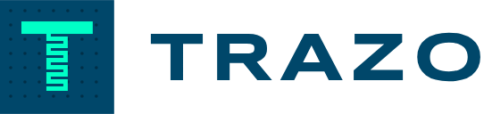
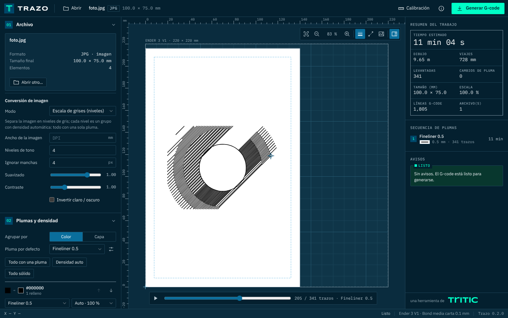

<p></p>

**Generador de G-code para plotter de pluma en impresoras 3D** · una herramienta de **Tritic**

Convierte **SVG, DXF, PNG y JPG** en G-code para dibujar con plumas, marcadores o
bolígrafos montados junto al hotend de una impresora 3D cartesiana (Ender 3 V1,
Ender 3 V2/Pro, Ender 5, TwoTrees Bluer, Tronxy, Anet A8, máquinas con Klipper…).

El **ancho de línea** se ajusta al diámetro de la punta:

- **Rellenos compensados:** el contorno se contrae ½ punta, así la tinta llega
  justo al borde del diseño y no lo rebasa.
- **Separación de pasadas:** es `punta × (1 − traslape)`.
- **Trazos más gruesos que la punta:** se dibujan con varias pasadas paralelas.
- **Detalles más finos que la punta:** se dibujan por su eje central, con aviso.
- **Escala de grises con una sola pluma:** cada color o capa puede llevar una densidad de tinta.


---

## 1. Cómo funciona y cómo se publica

Trazo es un **sitio web 100 % estático**. Todo el cálculo (lectura de archivos,
rellenos, optimización y G-code) corre **dentro del navegador** con
[Pyodide](https://pyodide.org) (Python compilado a WebAssembly), en un hilo
aparte para que la interfaz no se congele.

- **Privacidad:** los archivos del usuario **nunca se suben a ningún servidor**.
- **Sin backend:** no hay servidor que mantener ni costo por uso.
- **Primera visita:** se descargan ~17 MB (el motor). Después todo queda en
  caché y **funciona sin conexión**, incluso instalado como app (PWA).
- **Carga a demanda:** el lector DXF (~2.5 MB) solo se descarga al abrir un DXF.

### Publicar en tools.tritic3d.com (o cualquier hosting)
1. Descargue `trazo-web.zip`:
   - **Releases** del repositorio, si hay una versión publicada;
   - o **Actions → web**, el artefacto de la última ejecución.
2. Descomprímalo y suba **el contenido tal cual** a la carpeta deseada, por
   ejemplo `tools.tritic3d.com/trazo/`. Todas las rutas son relativas, así que
   funciona en cualquier subcarpeta.
3. **Requisitos del hosting:**
   - HTTPS (lo exige el modo sin conexión);
   - servir `.wasm` con tipo `application/wasm` (la mayoría ya lo hace);
   - no bloquear archivos `.whl` ni `.zip`.

   No hace falta ninguna cabecera especial ni configuración del servidor.

Opcional: con la variable de repositorio `DEPLOY_PAGES = true`, el workflow
publica cada cambio de `main` en GitHub Pages. Se puede usar como sitio de
prueba, o con un dominio propio apuntado por CNAME.

### Probarlo en local
```bash
pip install -e .[dev]
python tools/build_web.py          # arma site/ (descarga Pyodide la primera vez, ~390 MB)
python -m http.server -d site 8000 # abrir http://localhost:8000
```

---

## 2. Flujo de trabajo en la máquina

1. **Monte el soporte con resorte** junto al hotend y **mida el offset** de la
   punta respecto a la boquilla, en X y en Y, con un vernier. Anótelo en el
   perfil de la máquina (⚙ → *Offset pluma X/Y*): + es a la derecha o hacia el
   fondo. *El hotend y la cama no se calientan nunca.*
2. **Fije el material** contra una escuadra en la cama. Su posición va en el
   perfil del material (*Posición X/Y* de la esquina inferior izquierda).
   El grosor del material es importante: papel 0.1 mm, cartón 2 mm, MDF 3 mm, etc.
3. **Abra el archivo** en Trazo:
   - Asigne una pluma a cada color o capa.
   - Ajuste la escala, la posición y el relleno.
   - Revise la vista previa y descargue el `.gcode` a la **tarjeta SD**.
4. **En la impresora (modo *insertar*, por defecto):**
   - La máquina hace home **sin pluma**.
   - Baja sobre el primer punto del dibujo hasta la altura de contacto
     (grosor del material + holgura de la boquilla) y **pausa**.
   - Inserte la pluma hasta que **toque la superficie**, apriétela y
     presione la perilla para continuar.
   - Al dibujar, la máquina baja `presión` mm (0.5 mm por defecto) para
     comprimir el resorte, y sube `levantar` mm para los viajes.
5. **Varias plumas:**
   - **Un solo archivo:** antes de cada pluma nueva pausa para *retirar* la
     anterior, y luego pausa sobre el punto de inicio para *insertar* la nueva.
   - **«Un archivo por pluma»:** genera un `.zip` con un archivo por color.
     Úselo si el firmware no soporta `M0`.

> **Modo *fijo*:** si la pluma va siempre montada, use `contact_mode = fixed` y
> calibre `contact_z_fixed`, la Z en la que la punta toca la cama vacía; el
> grosor del material se suma solo. Cuidado: el `G28` de Z puede chocar la
> pluma contra la cama. Considere `home = xy`.

### Calibración de la pluma
Use el botón **Calibración** (o `trazo calibrate --pen "…"`). Dibuja:
- **cuadros con traslape del 0 al 40 %:** elija el que cubre parejo;
- **escaleras de líneas a 1×, 1.5× y 2× la punta:** sirven para medir el
  **ancho real**, que casi siempre supera al nominal porque la tinta se
  extiende. Ponga ese ancho en *Ancho de línea* de la pluma;
- **un círculo de 20 mm:** si no cierra limpio, revise la tensión de las correas;
- **una regla de hasta 100 mm:** si no mide eso, corrija los pasos/mm del
  firmware.

---

## 3. Formatos de entrada

| Formato | Qué se usa |
|---|---|
| **SVG** | Trayectos, formas, transformaciones y viewBox en mm reales. Se distingue entre contorno (*stroke*, con su ancho) y relleno (*fill*). Las capas son las de Inkscape. El `<text>` se dibuja con fuente Hershey de un trazo. |
| **DXF** | LINE, LWPOLYLINE/POLYLINE con arcos y ancho, ARC, CIRCLE, ELLIPSE, SPLINE, SOLID, HATCH (relleno), POINT, TEXT/MTEXT (Hershey) y bloques INSERT anidados. Respeta `$INSUNITS`; sin unidades, asume mm. Las capas apagadas o congeladas se omiten. |
| **PNG/JPG** | **Logo/silueta:** vectoriza con potrace; con «colores a separar» genera una capa por color. **Escala de grises:** separa N niveles con densidad automática para una sola pluma. **Dibujo de líneas:** extrae el eje central. **Foto/tonos:** rayado por niveles en varias direcciones. **Bordes:** detector Canny. |

**Texto:** las fuentes Hershey (*futural*, *scripts*, *timesr*…) se dibujan
con **un solo trazo**, ideal para plotter. Si necesita la tipografía exacta,
convierta el texto a trayectos en Inkscape (*Trayecto → Objeto a trayecto*) y
se rellenará como cualquier figura.

---

## 4. Rellenos y ancho de línea

- **Patrones:** zigzag (por defecto; une las líneas para levantar la pluma lo
  menos posible), líneas paralelas, cruzado, concéntrico o solo contorno.
- **Contorno y pasadas:** se pueden dar varias vueltas de contorno antes del
  relleno.
- **Trazos gruesos:** se respeta el ancho del diseño con pasadas paralelas, o
  se fuerza «siempre una pasada».
- **Tolerancia** (0.3 por defecto): un trazo hasta 30 % más ancho que la punta
  se dibuja con una sola pasada.
- **Recorte:** nada se dibuja fuera del área de dibujo (material − margen ∩
  alcance de la pluma).

### Escala de grises con una sola pluma (densidad)
Cada color o capa tiene, además de su pluma, una **densidad**: la fracción del
área que cubre la tinta.

- **Separación de líneas:** se abre la separación entre líneas del relleno.
  - Con líneas, zigzag o concéntrico: `punta ÷ densidad`.
  - Con relleno cruzado: `punta ÷ (1 − √(1 − densidad))`.
- **Opciones de densidad:**
  - **Sólido 100 %**, o un porcentaje fijo (90 … 10 %).
  - **Auto:** se calcula del tono del color usando la luminancia real, así
    un gris de pantalla se ve igual en el papel.
  - Por defecto, el **negro y los grises usan Auto** y los colores quedan sólidos.
- **Sin cambios de pluma:** varios grupos con la **misma pluma** se dibujan
  seguidos, sin pausas.
- **Modo de imagen «Escala de grises»:** separa una foto en N niveles de
  gris, cada uno como región rellena con su densidad: un retrato completo
  con un solo fineliner.
- **Curva de tonos:** aclara (valores > 1) u oscurece (< 1) todos los tonos
  automáticos.
- **Tonos parciales:**
  - no se contraen ½ punta, para que dos tonos vecinos no dejen una franja
    blanca entre ellos;
  - por defecto no llevan contorno ni enlazan líneas, para que los bordes no
    se marquen. Ambas cosas se pueden activar.
- **Dónde aplica:** la densidad aplica a rellenos y a trazos gruesos. Una línea
  de una sola pasada siempre sale al 100 %.

### Consejos de la interfaz
- **Mover el diseño:** arrástrelo en el lienzo; la caja azul muestra su medida
  y posición.
- **Navegar:** la rueda del ratón hace zoom y arrastrar fuera del diseño (o con
  Shift) mueve la vista. `F` ajusta la vista.
- **Original:** superpone el archivo de origen para comparar la vectorización.
- **▶ o barra de espacio:** anima el recorrido (orden de dibujo y posición de
  la pluma). La barra de recorrido permite revisar paso a paso.
- **Coordenadas:** abajo a la derecha de la barra se ven las del cursor, tanto
  de la pluma como de la boquilla. Sirven para ubicar la hoja en la cama.

## 5. Optimización
- **Orden de los trazos:** vecino más cercano con KD-tree. Los lazos cerrados
  pueden empezar en cualquier vértice y las líneas abiertas se invierten si
  conviene.
- **Unión de huecos:** si la separación es menor a ½ punta, el trazo continúa
  sin levantar la pluma.
- **Simplificación** de 0.02 mm, para no saturar el búfer de las placas de 8 bits.

En las máquinas con Z por husillo cada levantada cuesta cerca de 1 s, por eso
estos tres puntos son lo que más tiempo ahorra.

---

## 6. Compatibilidad de G-code

El programa solo usa `G0 G1 G4 G21 G28 G90 M0 M84 M104 M140 M107 M117 M204`.

| Firmware | Notas |
|---|---|
| **Marlin 1.x / 2.x** (Ender 3 stock, Ender 5, Bluer, Tronxy) | `M0` pausa hasta presionar la perilla (requiere pantalla). Se envía `M84 S0` para que los motores no se apaguen durante la pausa (el Ender 3 stock los apaga a los 120 s). |
| **Klipper** | Use el perfil «Genérica Klipper» (`pause_cmd = PAUSE`), que requiere `[pause_resume]` y las macros PAUSE/RESUME de Mainsail o Fluidd; continúe con *RESUME*. Si las pausas son largas, suba el `idle_timeout`. |
| **Anet A8 / firmwares antiguos** | Si `M0` no funciona, use «un archivo por pluma». Aceleración sin cambiar (`0`). |

Todo se configura por máquina: recorrido, offsets, velocidades, aceleración,
home, comando de pausa y mensaje, y G-code inicial/final extra.

---

## 7. Línea de comandos (opcional)

```bash
trazo dibujo.svg -o dibujo.gcode --pen "Fineliner 0.5" --fit
trazo plano.dxf --group-by layer --map CORTE="Sharpie fino" --map COTAS= --width 150
trazo logo.png --colors 3 --image-width 80 --per-pen -o salida/
trazo foto.jpg --raster-mode hatch --levels 4 --hatch-spacing 1.2 --preview prev.svg
trazo retrato.jpg --raster-mode grays --levels 6 --pen "Fineliner 0.3"
trazo plano.svg --density "#808080=40" --density "#ff0000=auto" --tone-gamma 1.2
trazo calibrate --pen "Sharpie fino" --material "Cartón 2 mm"
trazo profiles          # lista perfiles y dónde se guardan
```
La línea de comandos usa el mismo motor que la web; sirve para lotes o
automatización (`pip install -e .`).
En `--map CLAVE=`, una pluma vacía omite ese grupo. `--config ajustes.json` acepta el
mismo formato de ajustes que usa la interfaz.

## 8. Perfiles
Hay perfiles integrados de máquinas, plumas (de 0.1 mm a marcador de 2 mm) y
materiales (bond, cartulina, cartón, MDF, acrílico).

**En la web**, los perfiles propios (editados o duplicados) se guardan **en el
navegador** de cada usuario. Desde cualquier ficha de perfiles se pueden
**exportar** a un `.json` e **importar** en otra computadora o navegador.

**En la línea de comandos** se guardan en `%APPDATA%\Trazo\profiles.json`
(Windows) o `~/.config/trazo/profiles.json`; la variable `TRAZO_HOME` cambia
esa carpeta.

---

## 9. Interfaz y marca
La interfaz sigue el sistema visual **Tritic** («plano de taller»):
- **Tipografía:** IBM Plex Sans y Plex Mono (los datos y unidades van en
  mono), y Syncopate solo en el nombre TRAZO.
- **Trazado:** filetes finos en lugar de sombras y esquinas de 0–2 px.
- **Color:** un solo acento verde Tritic por vista, el botón *Generar G-code*.
- **Organización:** el flujo de trabajo va numerado con *chips* (01 Archivo →
  06 Salida) y el resumen del trabajo tiene forma de *cajetín* técnico.
- **Tema:** sigue el modo claro u oscuro del sistema.

Todas las tipografías van incluidas en el sitio (licencia SIL OFL 1.1), así
que funciona sin conexión.

**Logotipo** en `docs/marca/`:

| Archivo | Uso |
|---|---|
| `trazo-logo.svg` / `.png` | Símbolo + nombre, sobre fondo claro |
| `trazo-logo-blanco.svg` | Sobre azul Tritic o azul noche |
| `trazo-simbolo.svg` | Icono de la app; `trazo-simbolo-simple.svg` para 16 px |
| `trazo.ico` | Icono en formato Windows (16, 32, 48 y 256 px) |

El símbolo es un *chip* azul Tritic con retícula de puntos. La T va en verde
Tritic: la barra es un trazo sólido y el tallo, un **relleno en zigzag** de
una sola línea, la operación que hace el programa. `tools/logo.py` regenera
los archivos.



## 10. Desarrollo
```bash
pip install -e .[dev]
python tests/make_data.py                 # genera los archivos de prueba
pytest -q                                 # pruebas en Python normal
python tools/build_web.py                 # arma site/
node tools/test_pyodide.mjs .cache/pyodide-0.29.3/pyodide site   # pruebas DENTRO de Pyodide
```
Las pruebas corren dos veces, en Python normal y dentro de Pyodide. Las
bibliotecas compiladas a WebAssembly (en especial GEOS 3.12) no se comportan
igual que las nativas. Por eso todas las operaciones booleanas usan precisión
fija (`grid_size`): así no pueden fallar por topología, que en el navegador
detendría el motor. Si el motor llegara a caerse, la interfaz lo reinicia sola.

**Estructura:**
- `trazo/`: motor en Python, el mismo para la web y la línea de comandos.
  - `importers/`: SVG, DXF, imágenes
  - `fill.py`: rellenos y compensación de punta
  - `optimize.py`: orden de trazos
  - `pipeline.py`: disposición, plumas y recorte
  - `gcode.py`: escritura de G-code
  - `imgproc.py`: umbral, esqueleto, Canny y filtros, con numpy puro
  - `webapi.py`: lo que llama el navegador
- `web/`: interfaz (HTML/CSS/JS sin compilación).
  - `worker.js`: carga Pyodide y ejecuta el motor
  - `sw.js`: caché para trabajar sin conexión
- `tools/`:
  - `build_web.py`: arma el sitio
  - `test_pyodide.mjs`: corre las pruebas dentro de Pyodide
  - `logo.py`: genera el logotipo

### Pendiente / ideas
- Arcos `G2/G3` opcionales para archivos más pequeños.
- Fuentes TrueType como contorno.
- Punteado (*stippling*) para fotos.
- Envío directo por USB u OctoPrint.
- Soporte para servo (`M280`) en lugar de Z.
- Mejora 2-opt del orden.
- Regla *nonzero* exacta.
